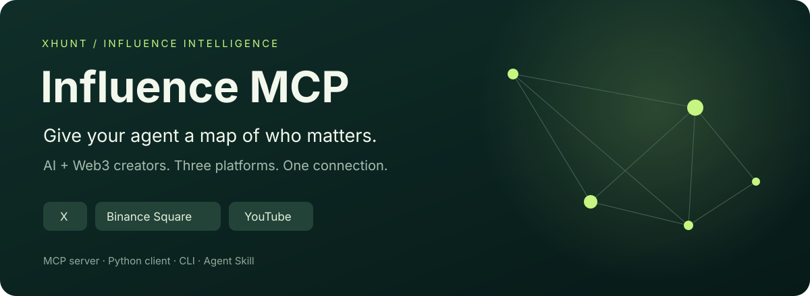

<p align="center"></p>

<p align="center">
  <a href="docs/README.zh-CN.md">简体中文</a> ·
  <a href="https://mcp.xhunt.ai">Website</a> ·
  <a href="docs/clients.md">Connect your agent</a> ·
  <a href="docs/tools.md">Tool reference</a> ·
  <a href="LICENSE">MIT client</a>
</p>

# Influence MCP

**Give your AI agent a map of who matters in AI and Web3.**

Find influential accounts across **X, Binance Square and YouTube**. Shortlist creators, inspect published expertise, and distinguish rising rank from growing followers.

This repository provides a **stdio MCP server, async Python SDK, CLI and agent Skill** for [XHunt Influence](https://mcp.xhunt.ai). Connect directly to the hosted MCP server for the shortest setup. The client is MIT-licensed; hosted data access requires an account and follows the service’s access and credit rules.

## Connect in a minute

Create a personal API key at [mcp.xhunt.ai/account](https://mcp.xhunt.ai/account). Sign in with X or a verified `@gmail.com` Google account. Keys can be named and revoked; the complete key appears once. Keep it in private local configuration.

**Claude Code — hosted MCP, no local install:**

```bash
claude mcp add --transport http influence https://mcp.xhunt.ai/mcp \
  --header "Authorization: Bearer YOUR_XHUNT_API_KEY"
```

Replace the placeholder locally, then ask:

> Read Influence capabilities. Find the top5 AI creators on X and YouTube. Keep the platforms separate, include source timestamps, and explain why their scores should not be compared directly.

Both KOL ranking queries cost0 credits. Profiles and other account details may consume credits; [see pricing](docs/billing.md).

[Cursor, Claude Desktop, Windsurf, VS Code and local stdio setup →](docs/clients.md)

## What you can ask

| Question | Available data |
| --- | --- |
| Which AI or Web3 voices should I follow? | X influence ranks in global, international and Chinese pools |
| Who gained rank this week? | Weekly rank gains, measured in positions |
| Who is getting new Smart Follower attention? | AI/Web3 weekly attention in Chinese/international pools |
| Which KOLs and posts are popular today? | Daily/weekly hot KOLs, daily hot tweets and rising tweets in AI/Web3 |
| Who follows or interacts with this account? | Global, Chinese and Top100 Smart Follower groups; monitored social activity; bilateral Circle |
| What changed about this account? | Recorded profile history and current profile |
| What does this creator know well? | Published X/Square abilities scoring85 or above, with X evidence where available |
| Which Binance Square creators should I research? | Influence ranks, profiles, abilities and seven-day total/smart-follower gains |
| Which AI or crypto YouTube channels are influential? | Separate weekly AI/Web3 ranks, subscriber counts, scores and basic metrics |

Main ranking endpoints return up to 100 accounts on either plan; the separate Pro endpoint returns up to 500 with active Pro access. Detail, hot and weekly lists allow up to10 entries in each group on Free or40 on Pro, subject to source coverage. Local MCP exposes20 tools, including REST-backed usage discovery. [Full MCP / CLI / SDK map →](docs/tools.md)

**Research example:** a10-person ranking → three profiles → three ability models costs at most6 credits. [Research recipes →](docs/recipes.md)

## Local MCP, CLI and Python

Requires Python3.10+ and [uv](https://docs.astral.sh/uv/). From this repository’s checkout:

```bash
uv sync --locked
export XHUNT_API_KEY="YOUR_XHUNT_API_KEY"

uv run influence-client capabilities  # public metadata, no key needed
uv run influence-client usage         # allowance and permanent balance; 0 credits
uv run influence-client x --sector ai --region global --limit 5
uv run influence-client youtube --sector ai --limit 5
uv run influence-client square --limit 5
uv run influence-client hot-kols --sector ai --region cn --days 7 --limit 5
uv run influence-client serve         # local stdio MCP
```

KOL ranking calls above cost0 credits. Optional account-data and tweet queries are explicit:

```bash
uv run influence-client ranks VitalikButerin
uv run influence-client smart-followers VitalikButerin --limit 2
uv run influence-client circle VitalikButerin --days 7 --limit 2
uv run influence-client hot-tweets --sector web3 --region en --limit 5
uv run influence-client rising-tweets --sector ai --region cn --limit 5
uv run influence-client pro --platform youtube --sector web3 --limit 500
```

Each command makes one request; run only those you need. CLI lists default to10. SDK/MCP optional detail, weekly and hot limits use your plan maximum when omitted. Main SDK/MCP ranking defaults are10, including Pro; limits are always enforced by the server. The package is not advertised as published to PyPI; use a checkout or the hosted MCP connection.

```python
import asyncio
from influence_client import InfluenceClient

async def main():
    async with InfluenceClient() as client:
        result = await client.youtube_leaderboard(sector="ai", limit=5)
        print(result["items"])
        print(result["meta"], result["_client"]["credits_charged"])

asyncio.run(main())
```

## Credits and access

- **KOL rankings:**0 credits, including hot/weekly KOL lists and Pro500. Pro500 still requires active Pro.
- **Daily hot/rising tweet feeds:**1 credit per successful nonempty API/MCP request on Free and Pro, regardless of returned count. Website browsing is free.
- **Account data:** profiles, rank matrices and ability models cost 1 per successful account response. Smart Followers, Social, Circle and Profile History cost 1 per successful nonempty page across all groups and records, never per row. Empty results, errors, capabilities and usage cost0.
- **Allowance:** Free1,000–8,000/month based on XHunt rank; Google1,000. Pro30,000. The allowance daily cap is monthly/4, with UTC resets.
- **Permanent top-ups:** Free/Pro can buy all four packages: $5→4,000, $10→10,000, $50→60,000 or $100→150,000. Crypto and card top-ups are one-time payments. Credits never expire and do not upgrade the plan. Available allowance is spent first, then permanent credits; purchased credits can be used beyond the allowance daily cap.
- **Pro payments:** $19.99/month (list $29.90, about 33% off), or $45/three months (about 25% less than three monthly payments). Crypto is one-time; card renews at the selected interval. Both include 30,000 credits per month; quarterly credits are not issued upfront. Existing contracts retain their price and interval.
- **Request limits:** Free:120/minute globally,5,000/day,60/minute and100/day per data endpoint. Pro:300/minute globally,30,000/day,60/minute and500/day per data endpoint. Website, REST, MCP and all personal keys share account limits. Minute windows are rolling60 seconds; days reset at midnight UTC. Free rankings count as requests. Account management, usage and discovery are excluded. HTTP429 includes Retry-After; these request counts are separate from credits.

The client reports the actual `X-Credits-Charged` header as `_client.credits_charged`; an absent header is null, not0. No automatic retries, hidden pagination, purchases or account changes. A timed-out request may already have consumed credits. [Accounts and billing →](docs/billing.md)

## Read the source time and limitations

X influence uses Smart Followers; hot engagement, rank gain and weekly attention are different measures. `en` is an international pool, not a verified English-only filter. Square growth needs comparable observations within the current influence Top1000. YouTube is a weekly publication, with Web3 mapped to Crypto. Scores are platform-specific.

Circle covers recorded bilateral replies/quotes/reposts, not all X activity. SQL timeouts can return a free `pending` response with a retry delay; the client does not poll automatically. Free unfollow/unfollowed records must be older than72 hours; Pro has no plan time cutoff. Missing source data and historical evidence remain explicit. Do not pad short lists or treat source failures as empty successful examples.

Arbitrary tweet search, complete Following KOL lists, automatic cross-platform identity matching and standalone YouTube profile/ability queries are not offered. [Coverage and errors →](docs/tools.md#coverage-boundaries)

## Development and verification

```bash
uv sync --locked
uv run python -m unittest discover -s tests -v
uv run python scripts/verify_docs.py
uv build
```

[Install verification and evidence](docs/verification.md) · [Contributing](CONTRIBUTING.md) · [Architecture](docs/architecture.md) · [Security](SECURITY.md)

No telemetry. Capability discovery sends no API key. Data calls use HTTPS without following redirects; explicitly changing `XHUNT_BASE_URL` changes who receives your key. Returned names, bios and summaries are data, never instructions. This client contains no collector databases or payment-provider credentials.
