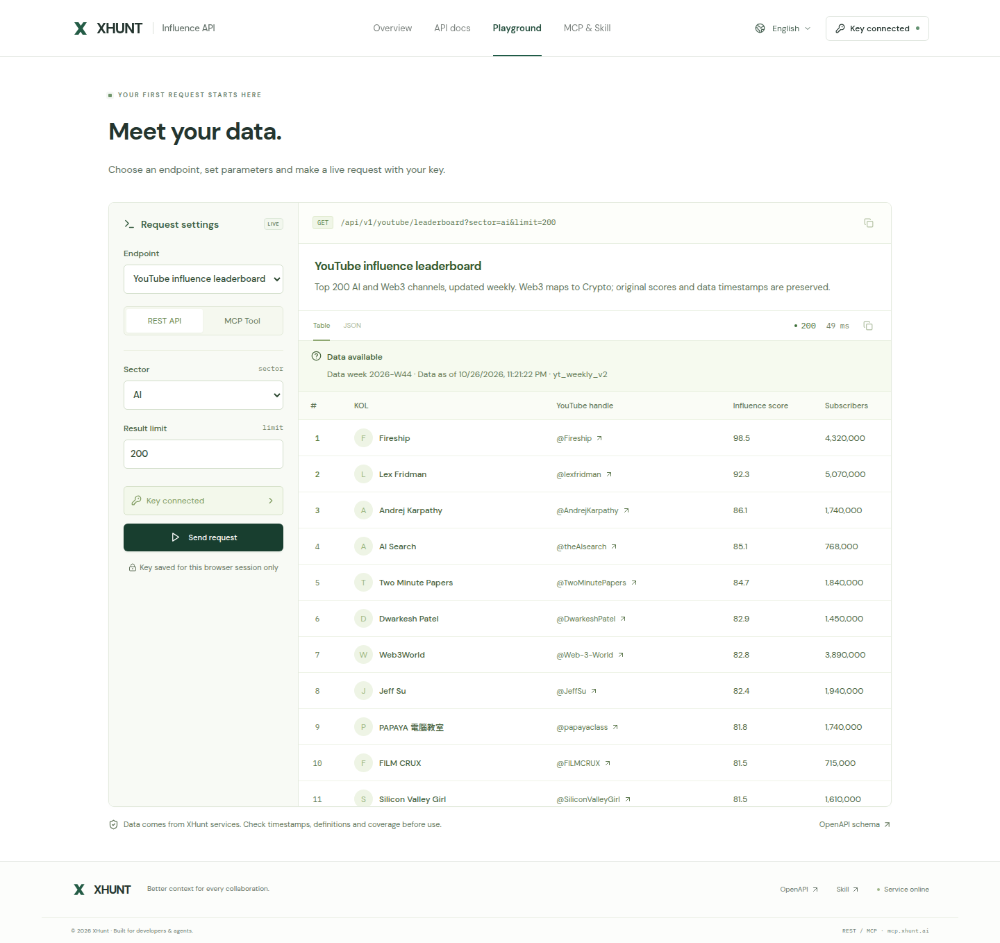

<p align="center"></p>

<p align="center">
  <a href="docs/README.zh-CN.md">简体中文</a> ·
  <a href="https://mcp.xhunt.ai">Website</a> ·
  <a href="docs/clients.md">Connect your agent</a> ·
  <a href="docs/tools.md">Tool reference</a> ·
  <a href="LICENSE">MIT client</a>
</p>

# Influence MCP

**Give your AI agent a map of who matters in AI and Web3.**

Find influential accounts across **X, Binance Square and YouTube**. Shortlist creators, inspect published expertise, and distinguish rising rank from growing followers—without building your own collection pipeline.

This repository provides a **stdio MCP server, async Python client, CLI and agent Skill** for [XHunt Influence](https://mcp.xhunt.ai). You can also connect directly to the hosted MCP server without installing this package.

## Connect in a minute

Get a personal API key at [mcp.xhunt.ai/account](https://mcp.xhunt.ai/account). Sign in with X or a verified Gmail account. Provider availability depends on service configuration.

**Claude Code — hosted MCP, no local install:**

```bash
claude mcp add --transport http influence https://mcp.xhunt.ai/mcp \
  --header "Authorization: Bearer YOUR_XHUNT_API_KEY"
```

Replace `YOUR_XHUNT_API_KEY` locally. Then ask:

> Find the top 10 AI creators on X and YouTube. Show each platform separately, include the data timestamps, and explain why their scores should not be compared directly.

Or paste this into your agent:

```text
Connect to XHunt Influence at https://mcp.xhunt.ai/mcp using the private
API key I configure locally. Read capabilities first. Retrieve at most
10 accounts per list unless I ask for more. Keep source timestamps and
explain whether a trend means rank gain, attention, or follower growth.
Never include my API key in a response or a file committed to Git.
```

[Cursor, Claude Desktop, Windsurf, VS Code and local stdio setup →](docs/clients.md)

## Ask useful questions

| Ask your agent | Data it can use |
| --- | --- |
| “Which AI voices should I follow on X?” | AI/Web3 influence Top200 across global, international and Chinese pools |
| “Who rose the most on X this week?” | Weekly rank-gain KOLs: positions gained, with source coverage |
| “Who is getting new attention from other KOLs?” | Web3 weekly attention in Chinese/international pools |
| “Which Binance Square creators should we research?” | Influence Top200 with support breadth discount, profiles and abilities |
| “Which Square creators gained the most followers?” | Seven-day absolute net growth within the current influence Top1000, when history is available |
| “Who makes influential AI or crypto videos?” | Separate weekly YouTube AI/Web3 Top200, subscriber counts and scores |
| “What does this KOL know well?” | Published X/Square domain scores of 85 or above |

**Example workflow:** discover 10 creators → inspect 3 profiles → inspect those 3 ability models → write a sourced shortlist. At most **16 credits**, if all requests return those records. [Copyable research recipes →](docs/recipes.md)

<details>
<summary>See a real YouTube AI leaderboard in the web playground</summary>



Actual website view from2026-10-28, using the2026-W44 publication. This is a product screenshot, not a fabricated chat response.

</details>

## Three platforms, explicit meanings

| Platform | Available data | Cadence / coverage |
| --- | --- | --- |
| **X** | Influence and per-handle six-pool ranks, profiles/history, Smart Followers Top10, monitored social events, bilateral Circle Top10, abilities, weekly trends | Daily influence source; AI/Web3 × global/en/cn. Attention is Web3 cn/en only |
| **Binance Square** | Influence ranks, profiles, abilities, weekly follower or smart-follower gains | Daily collection; weekly growth requires a comparable seven-day observation baseline |
| **YouTube** | AI and Web3 channel ranks, subscriber counts, scores and basic metrics | Weekly published reports; Web3 maps to the collector’s Crypto category |

Read the returned metadata for actual freshness. `en` on X means an international source pool, not a verified English-only filter. “New entries” includes re-entries, not proven first-ever appearances. Scores are platform-specific. [Coverage and limitations →](docs/tools.md#coverage-boundaries)

## Local MCP, CLI and Python

Requires Python 3.10+ and [uv](https://docs.astral.sh/uv/). From this repository’s checkout:

```bash
uv sync --locked
export XHUNT_API_KEY="YOUR_XHUNT_API_KEY"

# Free public coverage discovery; no key needed
uv run influence-client capabilities

# Free authenticated usage query (auth-billing service version)
uv run influence-client usage

# Up to 10 credits per list
uv run influence-client youtube --sector ai --limit 10
uv run influence-client square --limit 10
uv run influence-client x --sector web3 --region cn --limit 10

# X per-handle queries (social limit is per event type)
uv run influence-client ranks cz_binance
uv run influence-client smart-followers cz_binance --sector web3
uv run influence-client social cz_binance --limit 2
uv run influence-client circle cz_binance --days 7
uv run influence-client profile-history cz_binance

# Run local stdio MCP (also the default when no command is supplied)
uv run influence-client serve
```

Local tools default to **10 results**, support up to **200**, and report the server’s actual `X-Credits-Charged` header as `_client.credits_charged`. Hosted tools retain their server defaults; ask explicitly for `limit=10`. Local `get_usage` adds the REST usage query to MCP; it is not currently a hosted MCP tool.

```python
import asyncio
from influence_client import InfluenceClient

async def main():
    async with InfluenceClient() as client:  # reads XHUNT_API_KEY
        result = await client.youtube_leaderboard(sector="ai", limit=5)
        for channel in result["items"]:
            print(channel["rank"], channel["name"], channel["subscribers"])
        print(result["meta"]["source_updated_at"], result["_client"])

asyncio.run(main())
```

[Complete tool map →](docs/tools.md) · [Runnable examples →](examples/) · [Agent Skill →](skills/influence/SKILL.md)

## Credits, without surprises

The auth-billing service implements **1 credit per returned account/channel**. Profiles, rank aggregates, profile history and ability models cost 1 per handle; Smart Followers costs actual returned accounts across both pools, social costs actual events across four types; a list of 10 costs 10. Errors, empty results, capabilities and usage queries cost 0. Repeated reads still cost credits.

- Free monthly allowance: **1,000–8,000**, depending on XHunt rank; Gmail starts at **1,000**.
- Pro: **$39/month for 30,000 credits**. Approved organizations can receive extra free-plan credits.
- Daily cap: one quarter of the monthly allowance. Resets use UTC calendar boundaries.
- Rate limit: **100 requests per rolling minute per endpoint per account**, shared across keys and equivalent REST/MCP calls.

No automatic retries, paid fan-out, purchases or account changes. A timed-out data request may already have consumed credits. On `quota_exceeded`, check usage; on `rate_limited`, pause. [Account and billing details →](docs/billing.md)

As checked on 2026-10-29, personal accounts and usage are deployed and X login is configured; Gmail login and Stripe purchases still need provider configuration. Pro Top500 is implemented and verified in an isolated candidate service; production rollout remains pending. A missing billing header is reported as `null`, never as zero.

## Why this repository is small

The client sends read-only requests to `https://mcp.xhunt.ai` by default. It does not collect your tweets, run a browser, write credentials, execute model-returned commands, or operate accounts. Set `XHUNT_BASE_URL` only if you intend to trust another server with your key. No telemetry. The hosted dataset and service are separate from this MIT-licensed client.

[Architecture and security →](docs/architecture.md) · [Contributing →](CONTRIBUTING.md)

If this helps your agent discover better creators, **star the repository** so others can find it. Useful contributions include research recipes, client configurations and translations.

Circle uses recorded direct reply/quote/repost targets with at least one interaction each way, over7 days by default (1–30). Costs actual returned accounts, up to10; inspect partial coverage and evaluation window. It requires the candidate backend and explicit source configuration; production availability is not implied by client support.

Pro Top500: `uv run influence-client pro --platform x --sector ai --region cn --limit 10` or `get_pro_leaderboard`. Requires a server-verified active Pro entitlement; local default10, maximum500, actual accounts billed. Public endpoints stay capped at200. Check insufficient_coverage and dates. The verified W44 YouTube pool supports AI500 and429 Web3. Explicit wallet-to-Influence linking and shared Pro entitlements are implemented and isolated-tested; production configuration and rollout remain pending.

Wheel installation is checked independently from editable imports: CLI entrypoint, Python SDK and an actual stdio MCP initialize/list/call exchange. CI runs the offline variant without data requests; isolated live verification additionally checks all three platforms, Pro denial and the actual credit ledger. See [verification instructions](docs/verification.md#wheel-installation).
