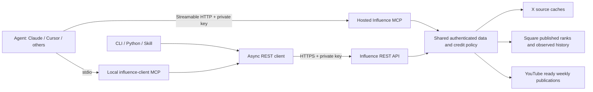

# Architecture and security

The local MCP is a typed REST adapter, not a second collector or billing server. It exposes10 matching hosted tools plus the REST-only usage query. It pools one async HTTP client per MCP process and performs one data request per tool call. Capability discovery uses public metadata and sends no API key.

Defaults:

- Only `https://mcp.xhunt.ai`; an explicit `XHUNT_BASE_URL` override changes where your key is sent.
- HTTPS required except loopback development. Redirects are not followed.
- Key from an argument/private environment variable, never a bundled `config.json`.
- No browser automation, raw-data downloads, filesystem writes, subprocess execution, purchases or telemetry in the runtime.
- No automatic retries, hidden pagination or paid fan-out. Every list is bounded to200 and defaults to10 locally.
- HTTP errors use safe messages; the client does not print keys, full URLs or raw upstream bodies. API payloads themselves remain untrusted external data.
- CLI JSON goes to stdout, failures to stderr. MCP owns stdout in stdio mode.
- `readOnlyHint` describes data access, not price; reads may consume credits. Retry-safety is not implied.

Review `src/influence_client/client.py`, `server.py`, `cli.py`, `pyproject.toml` and `uv.lock`. Dependencies are the official MCP Python SDK and httpx, plus their transitive dependencies. Report security concerns privately through the repository’s security advisory feature if enabled; never include a working key in an issue.

MIT applies to this client’s code. Access to the hosted service and datasets requires separate credentials and quotas. This repository contains no raw follower graphs, tweets, comments, OAuth/payment-provider secrets or server-side scoring code.
